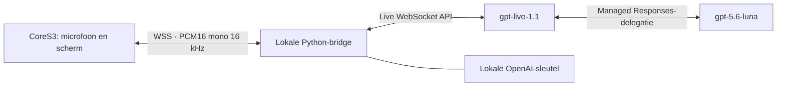

# StackChan met GPT Live — versie 1.0.0

Firmwareprototype voor de **officiële M5Stack StackChan met CoreS3**, met Nederlandse spraakgesprekken via **OpenAI `gpt-live-1.1`**. Een lokale Python-bridge op de Mac verbindt de robot met OpenAI. Die Mac moet tijdens gesprekken aanstaan en op hetzelfde bereikbare netwerk zitten. De OpenAI-sleutel blijft op de Mac.

Na afloop van een gesprek staat **Gesprek gestopt** in het midden tot de slaapstand ingaat. Tijdens luisteren en spreken toont het scherm andere audiogolven. Onderin staan de microfoon, het volume en de gespreksknop. Tijdens een gesproken antwoord draait of knikt het hoofd af en toe.

Zie [VALIDATION.md](VALIDATION.md) voor de regressietests, buildgegevens en de precieze grenzen van de verificatie. Maak bij een andere bridgecomputer of gewijzigde hostnaam een nieuw certificaat met `--renew`.

## Bediening

Tijdens een gesprek verdwijnen de knoppen na 10 seconden zonder aanraking. Tik ergens op het scherm om ze opnieuw 10 seconden te tonen. De eerste tik toont alleen de knoppen. Na afloop blijft Start in beeld tot de slaapstand ingaat.

- Na één minuut zonder gesprek of aanraking gaat het scherm uit en kantelt het hoofd naar de laagste gekalibreerde stand. Zeg tijdens een gesprek **‘Ga slapen’** of **‘Ga in slaapstand’** om het scherm meteen uit te zetten en het hoofd te laten zakken terwijl de bridge het gesprek afsluit. Op batterij gaan daarna wifi, audio en servovoeding uit en slaapt de processor tussen korte aanraakcontroles. Op USB-voeding blijven wifi, de bridgeverbinding en audio gereed. Strijk bovenop of tik op het scherm om de StackChan te wekken. Het hoofd komt omhoog, het scherm gaat aan op 30% en er start automatisch een gesprek zodra de bridge bereikbaar is. Spreek zodra de microfoon rechts verschijnt.
- Op batterij staat het laadpercentage rechts in de bovenbalk naast het wifi-icoon.
- Tik rechtsonder op **Start**. Spreek zodra de microfoon rechts verschijnt.
- Linksboven staan het bedrag van het huidige gesprek, **Totaal** voor GPT-Live-spraak en **Tools** voor Responses, Decisions en webzoeken, allemaal in dollars. Het gespreksbedrag begint bij **Start**, blijft staan tijdens gesloten wachttijd en telt verder na spraakhervatting. De bridge bewaart afgesloten GPT-Live-verbindingen, Responses en Decisions per aanvraag in `.local/voice-cost.sqlite3`. De doorlopende spraakteller omvat ook de schatting voor de actieve verbinding. Tools gebruikt het door OpenAI gemelde tokengebruik, de standaardtarieven van GPT-5.6 Luna en GPT-6 Luna en het gemelde aantal factureerbare webzoekopdrachten. De bridge neemt historische spraakduur mee uit de logs. De toolteller begint zodra die gebruiksvelden worden geregistreerd.
- De bridge sluit de OpenAI-sessie na 45 seconden zonder antwoord, uitgevoerde tool of aanvaarde spraakhervatting. Lopende lokale toolaanroepen mogen eerst afronden. Akoestische activiteitsmeldingen dienen als diagnostiek. De microfoon en luistergolf blijven zichtbaar. Een klein doorgestreept wolkje in de statusbalk geeft aan dat de sessie gesloten is. De microfoon blijft lokaal actief. Een drempel boven het achtergrondgeluid en een minimumduur helpen zachte geluiden en losse tikken te negeren. Tijdens het verbinden buffert de firmware de eerste woorden. Decisions beoordeelt na een spraakstart of de zin voor StackChan bedoeld is. De bridge houdt antwoorden en lokale tools tegen tot die beoordeling binnen is. Bij afwijzing sluit hij de sessie en wacht StackChan eerst op rust voordat de lokale detectie opnieuw kan starten. Recente gespreksregels blijven alleen in het werkgeheugen om context te kunnen meegeven. Tik op **Stop** om ook het wachten op spraak te beëindigen.
- Zeg **‘Pauzeer het gesprek’** of **‘Wacht op wake word’** voor de strikte pauze. De bridge herkent deze opdrachten ook rechtstreeks in de GPT Live-transcriptie. Alleen **Wacht op wake word** blijft op het scherm staan, op 25% helderheid. De melding verplaatst iedere 30 seconden en de bovenste leds pulseren groen tussen ongeveer 10% en 24%, met één puls per 3,6 seconden. De OpenAI-verbinding sluit. De StackChan stuurt microfoonaudio via de lokale TLS-verbinding naar de bridge, die offline met Whisper het begin van een zin controleert. **Chatty**, **Hey Chatty** en **Hi Chatty** openen GPT Live met dezelfde gesprekscontext, zonder Decisions. De bridge bewaart daarbij kort het begin van je vraag in het werkgeheugen.
- **Stop** stopt de lokale audio en sluit de OpenAI-sessie af.
- Met **Demp** linksonder zet je de microfoon stil. Tik op **Mic aan** om verder te praten.
- Zeg **‘Stop het gesprek’**, **‘Zet je volume op 70 procent’** of **‘Demp de microfoon’** om de StackChan zelf te bedienen. Na dempen tik je op **Mic aan** om weer te kunnen praten.
- Tik onderaan op het **volumepercentage** en gebruik **−** of **+** voor stappen van 10 procentpunt. De standaard is **90%**. Je keuze wordt na het gesprek bewaard. Het volumepaneel sluit na vijf seconden of zodra je opnieuw op het percentage tikt.
- Tijdens luisteren bewegen de groene balkjes vanaf de microfoon rechts naar links. Hun hoogte volgt het opnameniveau. Tijdens het antwoord slaan verticale balkjes uit op vaste posities, met dezelfde afstand als bij luisteren. Bij hardere spraak komen er paren bij, tot het patroon 1–3–1–2–1–2–1–3–1. Tijdens korte stiltes blijft de middelste lijn zichtbaar. Na circa 0,9 seconde zonder hoorbare spraak verschijnt de luistergolf weer.
- Bij elke gespreksstart controleert de StackChan de kantelstand en brengt hij het hoofd omhoog als het nog omlaag staat. Tijdens een antwoord beweegt het hoofd vanuit de gemeten stand en keert daarna terug. Tussen gebaren zit minstens 7,8 seconden. De knop **Stop** laat de actieve servo los.
- Tijdens een gesprek houdt de bridge de Mac wakker bij inactiviteit. Houd op batterij de klep open. Bij een verbroken verbinding geeft de StackChan na herstel aan dat je weer op Start kunt tikken. Een gesprek stopt automatisch na tien minuten.

De eerste versie ondersteunt **om de beurt praten**. Tijdens hoorbare robotspraak en een korte uitlooptijd gaat stilte naar het model om akoestische terugkoppeling te beperken. Er is geen AEC. Door de robot heen spreken om hem te onderbreken is dus nog niet ondersteund; Stop beëindigt het gesprek. De effectiviteit van deze eenvoudige echo-beveiliging moet fysiek worden beoordeeld.

## Ontwerp

Installeer voor het offline wekwoord `bridge/requirements-wake.txt` in de venv van de bridge en zet het officiële meertalige [whisper.cpp-basismodel](https://huggingface.co/ggerganov/whisper.cpp/blob/main/ggml-base.bin) in `.local/wake/ggml-base.bin`. De bridge laadt het model op de CPU tijdens het opstarten.



`gpt-live-1.1` gebruikt de **Live API**, met eigen eventnamen. De bridge opent `wss://api.openai.com/v1/live/sessions`, stuurt `session.start` en wacht op `session.started`. Daarna stroomt audio continu, inclusief stilte. De standaarddelegatie naar `gpt-5.6-luna` gebruikt hosted webzoeken en lokale Home Assistant-functies. De Live-commando's `response.item.create` en `response.create` geven toolresultaten terug en hervatten de backend; er wordt geen oude Realtime-audiocyclus gebruikt.

## Webzoeken en Home Assistant

Webzoeken staat standaard aan. Voorbeeld: “Zoek op wat er nieuw is in de laatste versie van Home Assistant.” Zoekresultaten worden kort uitgesproken met bronvermelding.

Op 17 november 2026 bevestigde de gebruiker dat de gesproken opdrachten voor beide functies werken, inclusief Home Assistant-apparaatbediening.

Home Assistant wordt apart aangemeld via `scripts/connect_home_assistant.py`. Open daarna de lokale aanmeldpagina op poort 8766; de aanmelding blijft in `.local/ha-auth.json` met rechten 0600. De bridge vernieuwt verlopen toegangstokens automatisch. Bij de lokale installatie is de native MCP-integratie met alleen **Assist** toegevoegd via de normale Home Assistant-configuratie-API, zonder YAML-wijzigingen of Home Assistant-herstart. Alleen voor Assist vrijgegeven apparaten zijn zichtbaar; deze vrijgave is niet uitgebreid.

Scripts die in Home Assistant voor Assist zijn vrijgegeven verschijnen als aparte functies. Zet de gekozen objectnamen zonder `script.` als kommagescheiden lijst in `STACKCHAN_HA_SCRIPTS` in `.env.local`. Start de bridge opnieuw om zijn gereedschapslijst te laden. Gebruik een expliciete opdracht, bijvoorbeeld ‘Start het script Avondlicht’.

Voor de AtomS3-ledstrip gebruikt StackChan het [AtomS3-script](docs/atoms3-ledstrip-script.yaml). Voeg het toe aan `scripts.yaml`, herlaad de scripts, geef `script.stackchan_atoms3_ledstrip` vrij aan Assist en voeg `stackchan_atoms3_ledstrip` toe aan `STACKCHAN_HA_SCRIPTS`. Zeg bijvoorbeeld ‘Zet het effect van de AtomS3-ledstrip op Rainbow’ of ‘Zet de AtomS3-ledstrip op groen’. Bij een vaste kleur wacht het script op de bevestiging van `Solid` en stelt daarna de kleur in.

De bridge vergelijkt gesproken namen met de vrijgegeven namen en aliassen uit Assist en de ingestelde scripttools. Spaties, leestekens, accenten en kleine typefouten mogen afwijken. Geef bij gelijknamige doelen zo nodig de ruimte of het soort, bijvoorbeeld lamp, script of scène. Bij vergelijkbare matches vraagt StackChan welke je bedoelt. Bij een gevonden schrijfvariant gebruikt de bridge de vrijgegeven naam voor de bediening. Als de gewone zoekactie geen match vindt, vergelijkt het Responses-model de omschrijving met vrijgegeven namen, aliassen, ruimtes en types. StackChan vraagt om bevestiging voordat hij een voorgesteld doel bedient.

De bridge onthoudt maximaal 32 bevestigde opdrachten voor één benoemd apparaat, één scène of een vrijgegeven script. Bij een exacte match op hetzelfde type opdracht kan StackChan de zoekstap overslaan. Home Assistant voert de opdracht opnieuw uit. De cache bewaart alleen naam, ruimte, domein, soort opdracht en vervaldatum in `.local/ha-target-cache.json`. Een doel vervalt na drie dagen of na een mislukte naam- of ruimtematch. Voor een actuele status vraagt StackChan Home Assistant.

Bij een naam zoals ‘Eettafel lamp’ of ‘eettafellamp’ telt ook ‘Eettafel’ mee. Een volledige naam krijgt voorrang. Het soortwoord beheerst het domein van de verkorte zoekopdracht. ‘Woonkamer warm script’ en ‘Woonkamer warm scène’ verwijzen daardoor naar elk hun eigen type doel.

Zeg bijvoorbeeld **‘Sla tv1 op als alias voor 32 inch The Frame’** en daarna **‘Zet tv1 aan’**. De bridge controleert het doel in Home Assistant en bewaart maximaal 32 uitgesproken aliassen in hetzelfde lokale cachebestand. Deze aliassen blijven bewaard na een herstart en hebben geen vervaldatum. Zeg expliciet dat je een bestaande alias wilt wijzigen om hem aan een ander doel te koppelen.

De adapter gebruikt `/api/mcp/assist` en biedt bekende Assist-functies voor status, lampen, klimaat, ventilatie en media. Bij “Zet de lampen in de keuken aan” stuurt Responses één groepsopdracht met de ruimte en het apparaattype. Bij een individueel doel gebruikt Responses ook de omschrijving, gesprekscontext en de vrijgegeven namen en aliassen. Bij onduidelijkheid die na die zoekstap overblijft, stelt StackChan een vraag. Een opdracht voor een slot vereist één exacte naam of alias die Home Assistant aan Assist heeft vrijgegeven. Voorbeeld van een statusvraag over één apparaat is “Staat de eettafellamp aan?”

De bridge haalt bij het opstarten en daarna elke vijf minuten de ruimtenamen en -aliassen uit het Home Assistant-ruimteregister en de vrijgegeven doelen uit Assist. Nieuwe GPT Live-sessies krijgen deze catalogus als compacte Responses-context met naam, type, ruimte en aliassen. Ook lege ruimtes en ingeschakelde StackChan-scripts staan erin. Responses kan een eenduidig doel direct bedienen. Voor actuele status of een onduidelijk doel kan het Home Assistant raadplegen. De catalogus bevat geen apparaatstatus of inloggegevens.

De toolworker werkt los van de audio. Opdrachten worden één keer uitgevoerd; Stop annuleert nog niet gestarte opdrachten. Een reeds naar Home Assistant verstuurde opdracht kan nog afronden. Fouten worden als fouten teruggegeven en beëindigen het spraakgesprek niet. Er is geen algemene REST-servicefallback.

macOS moet het Python-proces van de achtergrondbridge toegang geven onder **Privacy en beveiliging → Lokaal netwerk**. Werkt een test vanuit Codex wel, maar meldt de LaunchAgent `ha_unreachable` met `network_errno: 65`, controleer dan die toestemming. Na een nieuwe aanmelding of herstelde bereikbaarheid herstart je de bridge om de toolcatalogus opnieuw te laden. Het opstartlog moet `home_assistant_ready` melden.

`.venv/bin/python scripts/smoke_tools.py` controleert de echte Live-toolroute met één webzoekopdracht en alleen-lezen Home Assistant-status. Deze controle gebruikt de API maar bedient geen apparaten en bewaart geen inhoud.

De CoreS3 deelt I2S-pinnen tussen de ES7210-microfooncodec en AW88298-versterker. `AudioDuplex` beheert daarom één gezamenlijke RX/TX-driver. De gewone M5Unified-microfoon- en luidsprekerdrivers blijven uitgeschakeld. Hardware-audio gebruikt 16 kHz stereo en wordt naar mono gemengd; de luidspreker krijgt beide kanalen met een bescheiden digitaal volume. Dit is gelijktijdige elektrische opname/weergave, zonder akoestische echo-onderdrukking.

De hoofdservo’s hebben een eigen taak op core 1 met prioriteit 1. Opname en weergave hebben prioriteit 5 op core 0. De firmware leest de bestaande kalibratie en de servolimieten, controleert beide posities en geeft na elk gebaar het motorkoppel vrij. USB `DIAG` toont onder `head` de status, het aantal voltooide gebaren en de posities vóór, tijdens en na het laatste gebaar. USB `MOTION_TEST` voert in stand-by één gebaar uit.

## Bestanden

| Bestand | Doel |
|---|---|
| `firmware/src/main.cpp` | Bedieningsscherm, wifi/TLS, audioqueues, sessiestatus en USB-configuratie |
| `firmware/src/AudioDuplex.cpp` | CoreS3 I2S- en codec-aansturing |
| `firmware/platformio.ini` | Vastgepinde ESP32-S3- en bibliotheekversies |
| `bridge/stackchan_bridge.py` | Geauthenticeerde TLS-bridge naar OpenAI Live |
| `scripts/setup_local.py` | Lokaal certificaat en apart apparaattoken aanmaken |
| `scripts/provision_device.py` | Wifi en bridge-instellingen via USB in het apparaat opslaan |
| `scripts/build_firmware.sh` | Firmware compileren met PlatformIO |
| `scripts/smoke_live.py` | Korte expliciete API-controle met 200 ms stilte |
| `scripts/test_device_voice.py` | Herhaalbare akoestische gesprekstest op de fysieke StackChan |
| `tests/` | Tests met lokale gesimuleerde OpenAI-server en tijdelijke configuraties |

## Lokale installatie

Python 3.11 of nieuwer is nodig. De ingerichte projectomgeving gebruikt Python 3.12.

```sh
python3 -m venv .venv
.venv/bin/python -m pip install -r requirements-dev.txt
sh scripts/build_firmware.sh
```

De firmware staat daarna in `firmware/.pio/build/stackchan/firmware.bin`. Dit is de applicatie-image. Gebruik bij een volledige installatie PlatformIO, zodat ook de juiste bootloader en partitietabel worden geschreven; schrijf deze applicatie-image niet op een gegokt flashadres.

Bewaar je eigen OpenAI API-sleutel in `.env.local` als `OPENAI_API_KEY` en beperk de bestandsrechten tot `0600`. `.env.local`, `.local`, virtuele omgevingen en buildmappen zijn uitgesloten van Git. De sleutel wordt nooit in firmware opgenomen.

## Bridge en apparaat instellen

Kies het vaste LAN-adres of de bereikbare DNS-naam van de Mac waarop de bridge draait. Gebruik dezelfde naam bij certificaatgeneratie en apparaatconfiguratie. Vervang `BRIDGE_HOST` en `USB_POORT` hieronder door die echte waarden; wifi en wachtwoord worden lokaal gevraagd.

```sh
.venv/bin/python scripts/setup_local.py --host BRIDGE_HOST
.venv/bin/python bridge/stackchan_bridge.py \
  --cert .local/bridge.crt --key .local/bridge.key --host 0.0.0.0
```

De bridge kan op het lokale netwerk luisteren; zonder een afzonderlijk apparaattoken accepteert hij geen verbinding. Er is maximaal één verbonden robot. Zonder Start ontstaat geen betaalde OpenAI-sessie.

Open een tweede terminal om de firmware te flashen en het apparaat te configureren. Gebruik `provision_device.py` opnieuw bij gewijzigde verbindingsinstellingen. De bridgecomputer moet aan, wakker en bereikbaar blijven.

```sh
sh scripts/build_firmware.sh --target upload --upload-port USB_POORT
.venv/bin/python scripts/provision_device.py --port USB_POORT --host BRIDGE_HOST
```

De configuratie bevat wifi, bridge-adres, apparaattoken en het vertrouwde TLS-certificaat. Ze wordt via USB in NVS opgeslagen. NVS is in dit prototype niet versleuteld. Na opslaan herstart de robot en verbindt hij met wifi. Voor TLS moet hij via NTP de tijd kunnen synchroniseren. Certificaatcontrole wordt nooit uitgeschakeld. Een ander bridge-adres of vernieuwd certificaat vereist opnieuw provisioneren.

## Controles

```sh
.venv/bin/python -m unittest discover -s tests -v
sh scripts/build_firmware.sh
```

De tests gebruiken tijdelijke bestanden en lokale mockservers, zonder OpenAI-verbruik. Voor een expliciete korte controle met de echte sleutel:

```sh
.venv/bin/python scripts/smoke_live.py
```

Dit opent een betaalde Live-sessie, stuurt alleen stilte en sluit af. Het bewijst API-toegang en sessieopbouw, geen correcte weergave/opname op de robot en geen volledig gesproken gesprek of daadwerkelijke backenddelegatie.

De fysieke spraaktest gebruikt de StackChan, de lokale bridge en een echte OpenAI-sessie. De Mac maakt een korte Nederlandse testvraag en zet die via USB in het werkgeheugen van de robot. De StackChan speelt de vraag zelf af. Zijn microfoon levert de invoer. Het script meet per beurt de ontvangen antwoordframes en het microfoonsignaal bij de luidspreker. Het controleert de servofeedback, de audiobuffers en de bevestiging dat OpenAI de sessie heeft afgesloten.

```sh
.venv/bin/python scripts/test_device_voice.py --port /dev/cu.usbmodem101
```

De standaardtest duurt 110 seconden met drie vragen. Met `--stall` pauzeert de robot zijn netwerkverkeer één keer 650 ms tijdens een antwoord. Met `--stall-ms 1550` test je een langere onderbreking. Met `--tx-busy` simuleer je bovendien 3,2 seconden waarin de microfoonverbinding geen nieuwe gegevens kan aannemen. De test meet of aan beide kanten van een lege afspeelbuffer hoorbare spraak zat. Start in stand-by met het geluid aan. Er wordt alleen synthetische testspraak naar de robot gekopieerd. Net als in een gewoon gesprek verwerkt de microfoon gedurende de test ook hoorbaar omgevingsgeluid. Het rapport bevat tellers. Bij verlies van het USB-contact beëindigt de firmware een testgesprek na twaalf seconden zonder diagnostische aanvraag.

## Protocol en begrenzingen

De robot gebruikt WSS op `/device` met een Bearer-apparaattoken. Bij `start` wacht hij op `ready` met 16 kHz. De bridge bevestigt `mute` zodra OpenAI de wijziging bevestigt. `stop` sluit de sessie af.

De apparaten wisselen PCM16 mono uit. De brug en firmware v6 onderhandelen `pcm-pair-v1` via de HTTP-header `X-StackChan-Audio` en het antwoord `connected`. Een bericht bevat maximaal twee blokken van 20 ms. Een volledig stil bericht in beide richtingen gebruikt één byte voor het aantal blokken. De bridge herstelt die samples en klokt de oorspronkelijke 20 ms-blokken naar OpenAI. Oudere apparaten sturen en ontvangen één blok per bericht.

De firmware buffert maximaal 4,8 seconden opname en vier seconden weergave in PSRAM. Bij de start van een gesprek kiest hij een afspeelvoorraad van 1,8 seconde of, bij een wifi-signaal van −67 dBm of zwakker, 2,1 seconden. Bij volle buffers vervalt oude audio en stijgt een teller. Een echte lees- of schrijffout van het audioapparaat kan de sessie beëindigen. De bridge buffert bij het gepaarde PCM-protocol maximaal 4,8 seconden per richting. Bij een volle TCP-zendbuffer blijft de microfoonaudio op de robot in de wachtrij terwijl de netwerktaak binnenkomende spraak blijft verwerken. Na een pauze stuurt de bridge de opgebouwde voorraad in beide richtingen tijdelijk sneller door. De audiotaken draaien op core 0 met prioriteit 5. Netwerk gebruikt core 1 met prioriteit 3. Scherm en hoofdbewegingen gebruiken core 1 met prioriteit 1.


De weergavestand en de hoogte van de audiogolf volgen de lokale audio. De schermtaak leest alleen niveaumetingen uit de audiotaken. Bij afsluiten wacht de bridge maximaal vijf seconden op `session.closed`. Het bevestigde eindgebruik wordt onderscheiden van een verbinding die zonder die bevestiging verdwijnt. Gebruikstellerstanden zijn cumulatief en worden niet opgeteld. Gespreksaudio, transcripties en sleutels worden niet gelogd.

## Diagnostiek

`.local/logs/bridge-error.log` bevat JSON-metingen: apparaatstatistieken elke vijf seconden, sessiestatistieken elke vijftien seconden en de eerste stopreden. Onder andere wifi-signaal, blokkerende netwerkduur, audiobufferverlies, I2S-fouten, volume en geheugengebruik worden bijgehouden. `playback_underruns` telt ook normale stiltes na antwoorden; die teller alleen bewijst geen hoorbare hapering. Voor HA-aanroepen vermeldt `tool_status` de doorgegeven `name` en `area`. Een ontbrekende waarde verschijnt als `null`. Bij een gerapporteerde HA-fout bevatten `error_code` en, indien beschikbaar, `ha_detail` de reden. `tx_wait_max_ms` geeft de langste wachttijd vóór verzending en `failed_send_ms` de duur van een mislukte schrijfoperatie. `voiced_gap_ms` meet de duur van lege afspeelbuffers midden in herkende spraak. USB-opdracht `DIAG` geeft aanvullende hardwarestatus. Audio, transcripties en credentials worden niet gelogd. Open USB tijdens gesprekken liever niet: dat kan het apparaat resetten.

## Bronnen

- [OpenAI GPT Live-model](https://developers.openai.com/api/docs/models/gpt-live-1.1)
- [Live WebSocket-protocol en events](https://developers.openai.com/api/reference/resources/live/primary-websocket)
- [OpenAI WebSocket-audiogids](https://developers.openai.com/api/docs/guides/voice-websockets?api=live)
- [Officiële M5Stack StackChan-hardware](https://docs.m5stack.com/en/StackChan/)
- [M5Unified 0.2.12 codec-initialisatie](https://github.com/m5stack/M5Unified/blob/0.2.12/src/M5Unified.cpp)

MIT-attributie voor overgenomen codec-initialisatie staat in `AudioDuplex.cpp`.
